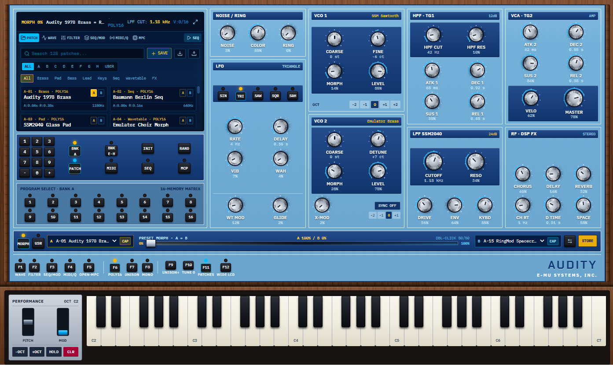

# Audity '78

**Lumina Aerospace LLC.** A 16-voice wavetable synthesizer inspired by the 1978 E-mu Systems Audity prototype: two wavetable oscillators, an SSM2040-style 24 dB low-pass and 12 dB high-pass, two transient generators, a five-shape LFO, noise and ring mod, and a stereo effects stage. It ships with 128 factory patches in eight banks.

> **Unofficial tribute.** Audity '78 is an independent emulation by Lumina Aerospace LLC. It is not affiliated with, endorsed by, or sold by E-mu Systems or Creative Technology. All waveforms are synthesised in code (`src/data/wavetables.ts`); no E-mu ROM or sample data is included.

## Status: please read

This repository is the **reference emulator**: a TypeScript/WebAudio build (React + Vite) that fixes the sound, the parameter set and the patch library. The shippable plugin is the **native VST3 port**, which is in progress (see [`docs/VST3-PORT.md`](docs/VST3-PORT.md)).

It is **not yet** a native MPC plugin and is not ready for the Open-MPC catalogue, whose entries are native plugin builds. This repo is not a catalogue submission yet.

## What is in it

| Section | What it does |
|---|---|
| **VCO 1 / VCO 2** | Wavetable oscillators (128-sample single cycles) with morph, octave, coarse/fine tune, PWM, hard sync and cross-mod FM |
| **Noise / Ring** | Noise level and colour (dark pink to white), ring modulator |
| **HPF + LPF** | 12 dB high-pass and 24 dB SSM2040-style low-pass with resonance, drive, envelope amount and key tracking |
| **TG1 / TG2** | Two transient generators (ADSR): TG1 for filter, TG2 for amplitude, with velocity sensitivity |
| **LFO** | Sine, triangle, saw, square, sample and hold, 0.05 to 28 Hz, delay fade-in, to pitch, filter and wavetable morph |
| **Voices** | Poly16 (steals oldest), Unison with detune, Mono with glide |
| **RF / DSP FX** | Stereo chorus, delay and reverb |
| **Patches** | 128 factory patches, banks A to H with 16 slots each, plus a user bank. Categories: Brass, Pad, Bass, Lead, Keys, Seq, Wavetable, FX |
| **Preset morph** | Crossfade between two patches (A and B) with the morph slider |
| **MIDI** | Web MIDI input, notes, pitch bend, mod wheel (CC1), mappable CCs with MIDI Learn |
| **Open-MPC page** | 16 Q-Link slots, two banks of eight, mapped to parameters and CCs |
| **FX8010 viewer** | Microcode editor and parser for the E-mu FX8010 instruction set (viewer and validator, not an audio engine) |

Source layout: `src/audio/AudityEngine.ts` (voices and signal path), `src/audio/patchMorph.ts` (A/B morph), `src/data/` (patches, wavetables, parameter descriptors), `src/types/synth.ts` (the patch model).

## Run it

You need Node.js. No API key is needed.

    npm install
    npm run dev        # http://localhost:3000
    npm run build

Use a Chromium-based browser for MIDI input. Click once on the page so the browser allows audio to start.

## Roadmap

1. Native VST3 (C++ and FAUST DSP, matching the parameter set in `src/types/synth.ts`).
2. More wavetable banks and a second factory-patch batch, built from original or openly licensed material.
3. Open-MPC build, once the VST3 DSP is settled.

## Licence

MIT, Copyright (c) 2026 Lumina Aerospace LLC. See [`LICENSE`](LICENSE).
