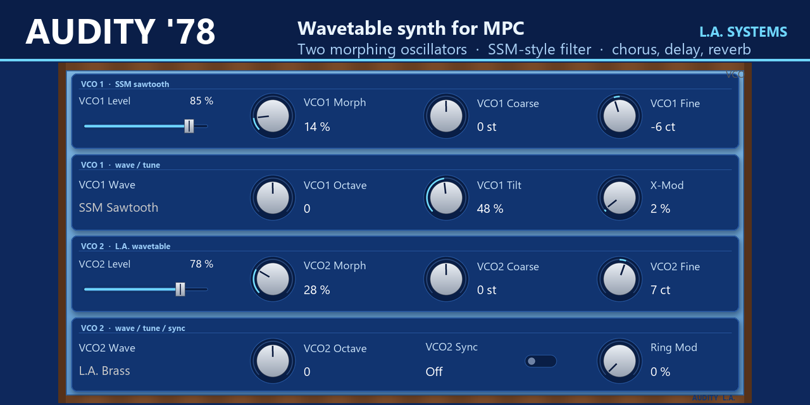
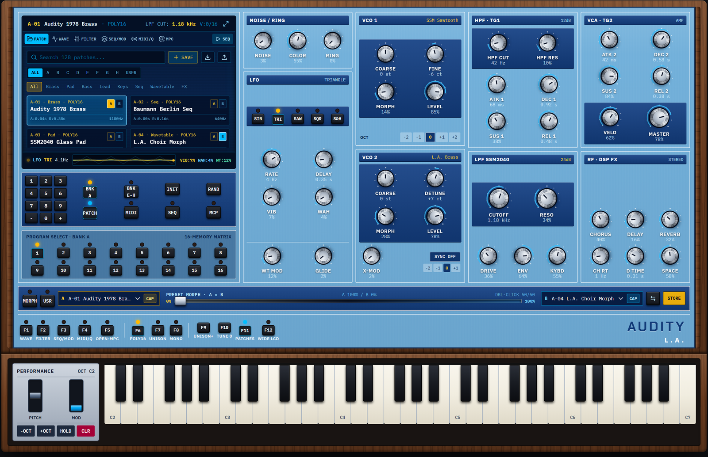

# Audity '78

*The plugin's own touch-screen pages (the blue L.A. skin), drawn by the SDK previewer at default values. All six pages: [`docs/screenshots/contact_sheet.png`](docs/screenshots/contact_sheet.png).*

**Reference emulator (browser, not the MPC screen).** This is the front panel the MPC plugin's sound and parameters come from, and the look the MPC skin above is drawn after; the desktop VST3 is planned from it.

**Lumina Aerospace LLC.** A wavetable synthesizer (16 voices in the reference, 8 on the MPC) after the 1978 Audity prototype, carrying the **L.A.** (Lumina.Aerospace) mark (the original is out of production): two wavetable oscillators, an SSM2040-style 24 dB low-pass and 12 dB high-pass, two transient generators, a five-shape LFO, noise and ring mod, and a stereo effects stage. It ships with 128 factory patches in eight banks.

> **Independent project.** Audity '78 is by Lumina Aerospace LLC and is not affiliated with the makers of the original instrument. All waveforms are synthesised in code (`src/data/wavetables.ts`); no third-party ROM or sample data is included.

## Status: please read

This repository holds two things:

- **The MPC plugin (VST2, Akai MPC OS, Gen1 and Gen2)**: `src/Audity78.cpp` (wrapper) on the shared DSP core `src/lumina/audity_core.hpp`, with `plugin.json` and `ui.json`. It builds with the MPC Plugin SDK for 32-bit ARM and 64-bit ARM with 0 errors and 0 warnings, and passes the SDK host simulator (19 checks, 0 failures; 52 parameters, 16 programs, state round-trip, block sizes 32 to 512). **It has not been run on a real MPC yet**, and CPU on a device has not been measured (the host simulator reports 0.26% of the block budget on a desktop CPU, for orientation only).
- **The reference emulator** (`src/` TypeScript, React + Vite): the WebAudio build that fixes the sound, the parameter set and the 128-patch library. The native plugin takes its wavetables, parameter ranges and bank A (16 programs) from it via `tools/export_data.mjs`.

A desktop VST3 and desktop app are planned as a separate build after the catalogue release.

Listed in the Open MPC catalogue as 0.1.0 (Listed tier, not yet device-tested). 0.2.0 adds the blue panel skin, fixes the installer line endings and adds the licence notices. A device smoke test is still to do; steps are in [`docs/MPC-RELEASE.md`](docs/MPC-RELEASE.md).

### Known gaps in the MPC build

- Wavetable lookup is not band-limited, so bright tables alias on high notes.
- 8 voices (the reference has 16). Raise `AUDITY_MAX_VOICES` only after a device CPU bench. Unison uses 3 voices per note.
- VCO2 Sync is true hard sync; the reference approximates it with a pitch shift.
- Mod matrix and step sequencer are not implemented. Only bank A is on the MPC so far.
- The touch skin (blue L.A. panel, six pages) is generated by `tools/make_blue_skin.py` on top of the SDK layout from `ui.json`: original artwork, but no live displays (patch browser, wavetable view, morph slider) yet. Previewed in the SDK previewer only; not yet seen on a device.

## What is in it

| Section | What it does |
|---|---|
| **VCO 1 / VCO 2** | Wavetable oscillators (128-sample single cycles) with morph, octave, coarse/fine tune, PWM, hard sync and cross-mod FM |
| **Noise / Ring** | Noise level and colour (dark pink to white), ring modulator |
| **HPF + LPF** | 12 dB high-pass and 24 dB SSM2040-style low-pass with resonance, drive, envelope amount and key tracking |
| **TG1 / TG2** | Two transient generators (ADSR): TG1 for filter, TG2 for amplitude, with velocity sensitivity |
| **LFO** | Sine, triangle, saw, square, sample and hold, 0.05 to 28 Hz, delay fade-in, to pitch, filter and wavetable morph |
| **Voices** | Poly16 (steals oldest), Unison with detune, Mono with glide |
| **RF / DSP FX** | Stereo chorus, delay and reverb |
| **Patches** | 128 factory patches, banks A to H with 16 slots each, plus a user bank. Categories: Brass, Pad, Bass, Lead, Keys, Seq, Wavetable, FX |
| **Preset morph** | Crossfade between two patches (A and B) with the morph slider |
| **MIDI** | Web MIDI input, notes, pitch bend, mod wheel (CC1), mappable CCs with MIDI Learn |
| **Open-MPC page** | 16 Q-Link slots, two banks of eight, mapped to parameters and CCs |
| **FX8010 viewer** | Microcode editor and parser for the L.A. FX8010 instruction set (viewer and validator, not an audio engine) |

Source layout: `src/audio/AudityEngine.ts` (voices and signal path), `src/audio/patchMorph.ts` (A/B morph), `src/data/` (patches, wavetables, parameter descriptors), `src/types/synth.ts` (the patch model).

## Build the MPC plugin

You need the [MPC Plugin SDK](https://github.com/inmusic-software/mpc-plugin-builder-sdk) checked out next to this folder, and Python.

    python <sdk>/tools/build.py "<this folder>"            # native + arm32 + arm64 + skins + validation
    <sdk>/.sdk-tools/host_sim <this folder>/build/native/audity-78.dll test --wav out.wav
    python <sdk>/tools/package.py "<this folder>"          # release zip

The output folder is `build/Lumina Aerospace LLC - VST - Audity 78/`. Regenerate the wavetable and program data after changing the reference (`src/data/`): `node tools/export_data.mjs` (Node 22.6 or newer). A quick native check of the core alone: `g++ -std=c++17 -O2 -I src/lumina tools/host_test.cpp -o build/host_test && build/host_test`.

## Run the reference emulator

You need Node.js. No API key is needed.

    npm install
    npm run dev        # http://localhost:3000
    npm run build

Use a Chromium-based browser for MIDI input. Click once on the page so the browser allows audio to start.

## Roadmap

1. Device test on an MPC, CPU bench, then the MPC release through the [Open MPC workflow](docs/MPC-RELEASE.md).
2. Banks B to H on the MPC; band-limited wavetables; custom skin.
3. Desktop VST3 and desktop app (after the catalogue release).
4. A second factory-patch batch and more wavetables, from original or openly licensed material only (the catalogue rejects sound content you have no right to share).

## Licence

MIT, Copyright (c) 2026 Lumina Aerospace LLC. See [`LICENSE`](LICENSE).
